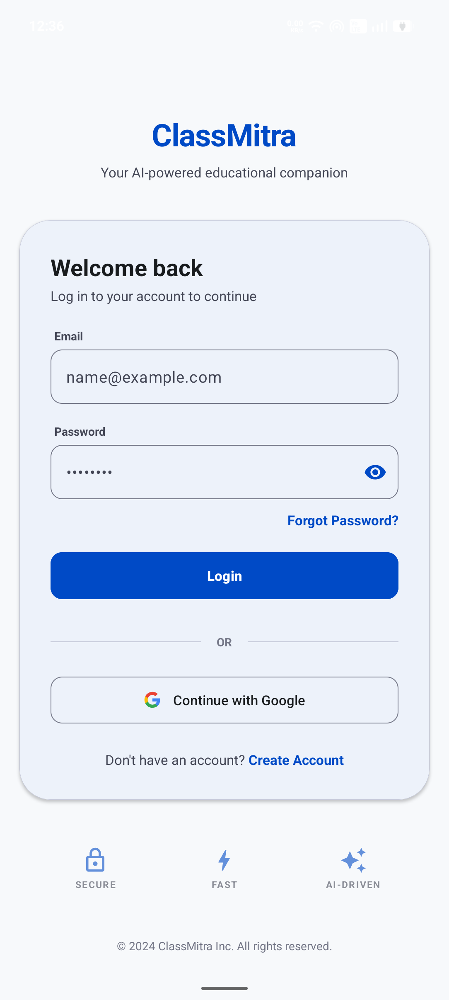
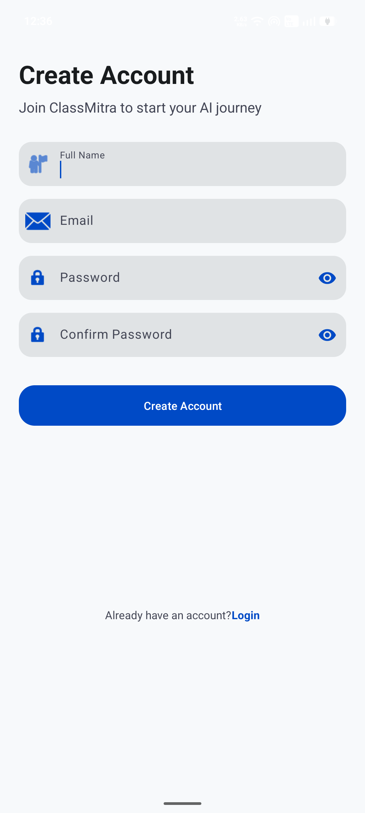
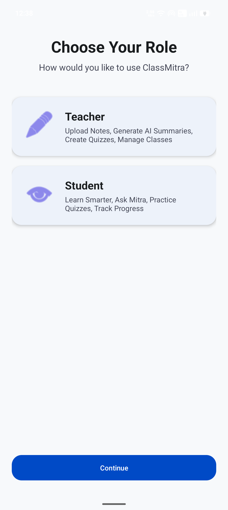
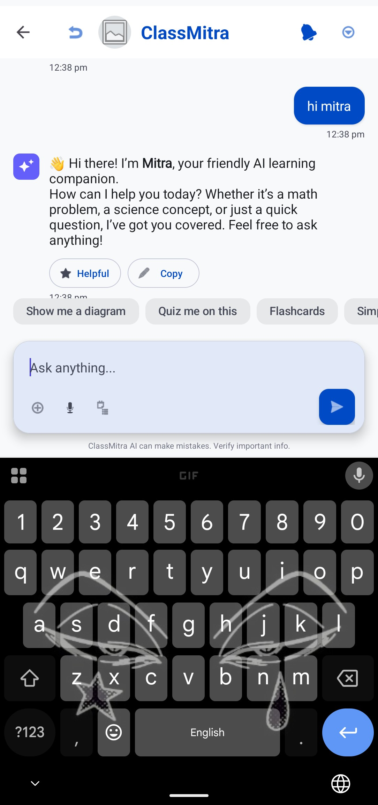
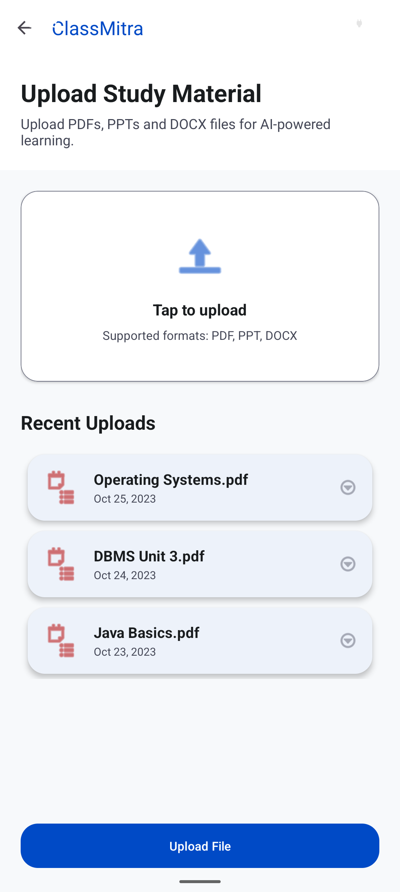
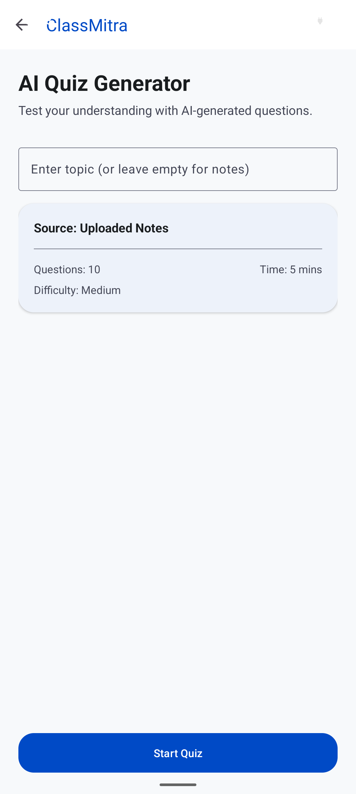
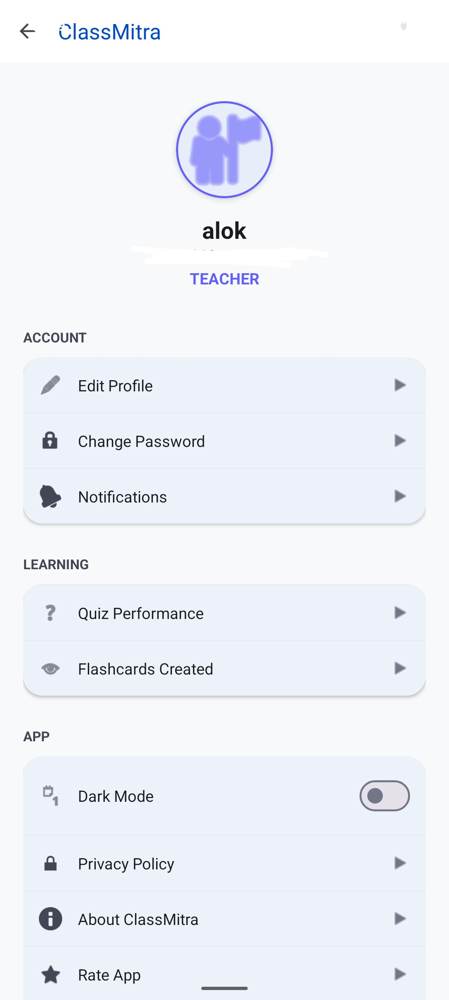
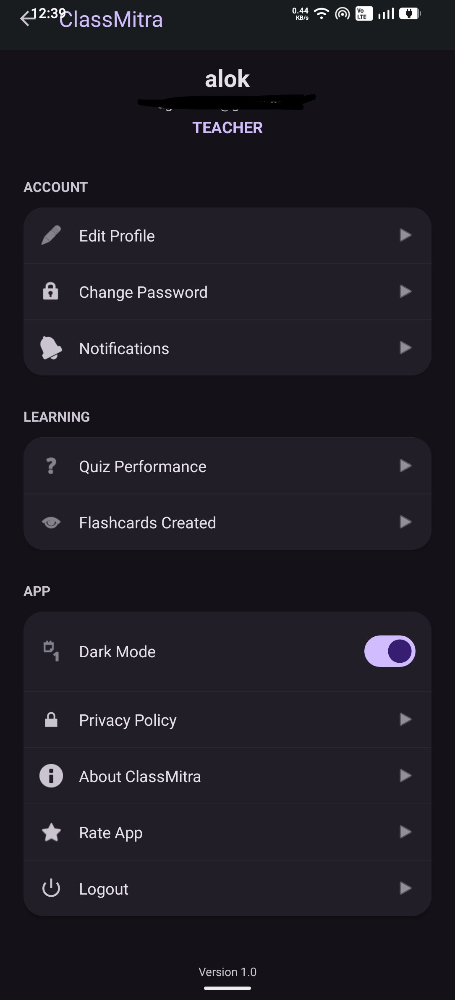
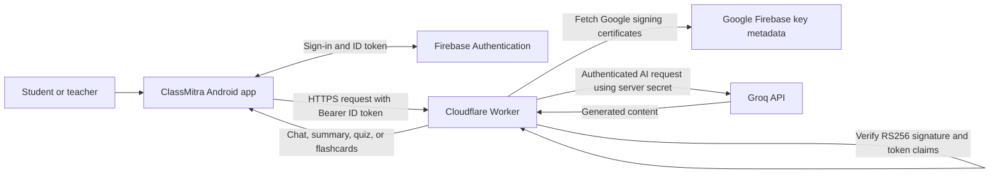

# ClassMitra


**ClassMitra is an AI-powered Android learning companion that helps students turn study material into clear explanations and practical revision tools.** The app combines Firebase Authentication, an Android client, and a Cloudflare Worker that verifies user tokens and securely requests AI content from Groq.

The Android package is `com.classmitra.app`. The Worker is configured at `https://classmitra-backend.classmitra-alok.workers.dev`.

## Features

- **AI chat** for text-based study questions and explanations.
- **PDF summaries** generated from extracted document text.
- **Quiz generation** with multiple-choice questions.
- **Flashcard generation** for revision.
- **Firebase Authentication** for signed-in user access.
- **Student and teacher experiences**, including dashboards and study-material workflows.
- **Dark mode** and profile/settings screens.
- **Authenticated backend requests** over HTTPS; the Groq credential stays on the server.

> Image input is present in the Android chat integration, but vision is disabled in the current Worker configuration.

## App screenshots

Screenshots below use the original filenames in [`screenshots/`](screenshots/).

### Welcome and onboarding

<p align="center">
  
  
</p>

### Authentication and roles

<p align="center">
  
  
  
</p>

### Student and teacher dashboards

<p align="center">
  
  
</p>

### AI study tools

<p align="center">
  
  
  
  
</p>

### Settings and appearance

<p align="center">
  
  
</p>

## Tech stack

| Area | Technologies |
|---|---|
| Android | Java 11, Android SDK, Gradle, View Binding |
| Authentication | Firebase Authentication and Firebase ID tokens |
| Document processing | PDFBox-Android |
| Markdown rendering | Markwon |
| Backend | Cloudflare Workers, Wrangler, JavaScript |
| AI | Groq Chat Completions API; configured text model `openai/gpt-oss-20b` |

## System architecture



The Android client sends requests to the Worker. The Worker verifies the Firebase ID token before forwarding AI requests to Groq. The Groq API key is configured as a Worker secret and is not part of the Android app.

## Backend and API

Base URL: `https://classmitra-backend.classmitra-alok.workers.dev`

All AI endpoints accept JSON `POST` requests and require:

```http
Authorization: Bearer <Firebase-ID-token>
Content-Type: application/json
```

| Method and path | Request JSON | Purpose |
|---|---|---|
| `GET /health` | — | Public health and configured-model status |
| `POST /chat` | `{"prompt":"..."}` | Educational chat response |
| `POST /summary` | `{"text":"..."}` | Summarize extracted study material |
| `POST /quiz` | `{"text":"..."}` | Generate a multiple-choice quiz |
| `POST /flashcards` | `{"text":"..."}` | Generate revision flashcards |

Successful AI responses use a JSON object with a `response` field. Quiz and flashcard response content is a JSON array encoded as a string.

## Run the Android app

1. Open the project in Android Studio with an Android SDK installed.
2. Ensure `app/google-services.json` is configured for the Firebase project. This file is intentionally not tracked in this repository.
3. Build and test from the project root:

   ```bash
   ./gradlew :app:assembleDebug :app:testDebugUnitTest
   ```

   On Windows:

   ```powershell
   .\gradlew.bat :app:assembleDebug :app:testDebugUnitTest
   ```

The Worker URL is set through `WORKER_BASE_URL` in `app/build.gradle.kts`. Update that value when targeting a different HTTPS Worker endpoint.

## Run the backend locally

Requirements: Node.js/npm and a Cloudflare account for deployment (Wrangler local development can run without deploying).

```bash
cd classmitra-backend
npm ci
```

For local AI requests, create `classmitra-backend/.dev.vars` from `.dev.vars.example` and set `GROQ_API_KEY` there. Keep `.dev.vars` private; it is ignored by Git. Then start the local Worker:

```bash
npm run dev
```

Wrangler serves the local Worker at `http://localhost:8787` by default. Check its health route at `http://localhost:8787/health`. AI routes still require a valid Firebase ID token. The Android client enforces HTTPS, so point it at an HTTPS endpoint when testing the app against a local Worker.

Run backend tests with:

```bash
npm test
```

## Deploy the backend

From `classmitra-backend/`, authenticate Wrangler, configure the Groq key as a Cloudflare Worker secret, then deploy:

```bash
npx wrangler login
npx wrangler secret put GROQ_API_KEY
npx wrangler deploy
```

Enter the secret only through Wrangler’s prompt; do not put it in source code, Android resources, or committed configuration. The Worker name, entry point, Firebase project, and model settings are defined in [`classmitra-backend/wrangler.toml`](classmitra-backend/wrangler.toml). If the deployed Worker URL changes, update `WORKER_BASE_URL` in `app/build.gradle.kts` and rebuild the app.

## Security notes

- AI endpoints require a Firebase ID token in the `Authorization` Bearer header.
- The Worker checks the token signature and expected Firebase claims before processing protected requests.
- `GROQ_API_KEY` belongs in Cloudflare Worker secrets (or the ignored local `.dev.vars` file), never in the Android application.
- Android requests use HTTPS for the Worker connection.
- The Worker’s in-memory rate limit is isolate-local; it is not a global, cross-region limit.
- Worker CORS currently allows all origins. CORS is not an authentication boundary; API access is protected by Firebase token verification.

## Project structure

```text
ClassMitra/
├── app/
│   └── src/
│       ├── main/
│       │   ├── java/com/classmitra/app/
│       │   │   ├── activities/    # Onboarding, profile, and app-level screens
│       │   │   ├── ai/            # AI client, PDF extraction, document data
│       │   │   ├── auth/          # Login, registration, and role selection
│       │   │   ├── chat/          # Chat experience
│       │   │   ├── flashcards/    # Flashcard experience
│       │   │   ├── quiz/          # Quiz experience
│       │   │   ├── student/       # Student dashboard and progress
│       │   │   └── teacher/       # Teacher dashboard and material workflows
│       │   └── res/               # Layouts, drawables, and app resources
│       └── test/                  # Android unit tests
├── classmitra-backend/
│   ├── src/index.js               # Cloudflare Worker and API routes
│   ├── test/                      # Backend tests
│   └── wrangler.toml              # Worker configuration
├── gradle/                        # Gradle wrapper and version catalog
├── screenshots/                   # App screenshots shown above
├── build.gradle.kts
├── settings.gradle.kts
└── README.md
```

## Project status and future scope

The Android app and Cloudflare Worker are configured for the deployed ClassMitra backend. Core flows include authenticated AI chat, PDF summaries, quizzes, and flashcards. The Worker health endpoint is available at the base URL’s `/health` path. Vision is currently disabled in Worker configuration.

Potential next steps:

- Enable and test a supported vision model for image-based study questions.
- Add globally coordinated rate limiting if usage requirements call for it.
- Expand automated integration testing for Firebase token verification and AI provider responses.
- Add release automation and broader device testing.

---

Built as an academic project to make everyday studying more interactive.
